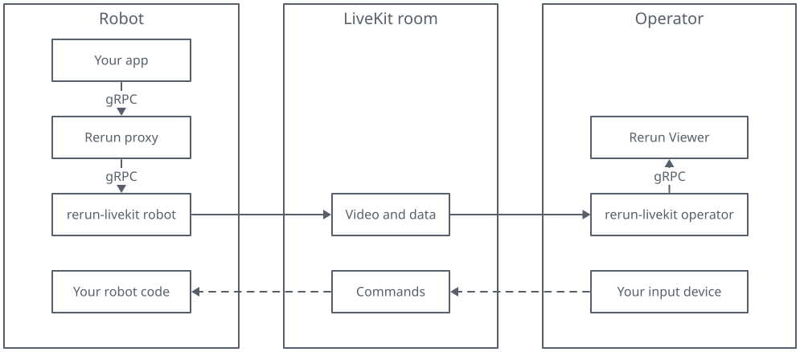

# rerun-livekit

Bridge any [Rerun](https://rerun.io) stream through [LiveKit](https://livekit.com), for a network adaptive, low latency remote connection between the Rerun Viewer and your robot.

Rerun streams over gRPC, which ensures delivery of every message in order, however long that takes.
This is the correct transport for logging and visualizing served data.
However, when teleoperating, low latency is the priority.
This bridge forwards the gRPC stream over WebRTC instead.

<picture>
  <source media="(prefers-color-scheme: dark)" srcset="docs/bridge-dark.svg">
  
</picture>

Your app and the Viewer do not change.
The app logs to a Rerun proxy on the robot, and the operator's Viewer receives the same recording: the same entity paths, archetypes, timelines, row ids and blueprint.
Only the pixels of images and the number of messages differ.
Any number of operators can watch, and one at a time can [drive](#send-commands-to-the-robot).

## Why WebRTC

On a link that carries less than the app logs, the guarantees of [gRPC](https://rerun.io/docs/reference/grpc) work against you:

- Nothing is dropped, so data queues up and the Viewer falls behind the robot.
  When the queues are full, the app's log calls [block](https://rerun.io/docs/reference/sdk/micro-batching#backpressure).
- gRPC runs on TCP, so one lost packet holds up everything sent after it.
- Nothing adapts to the link.
  The only remedy is to log less.

WebRTC makes the opposite trade.
It was built for calls, where data that arrives late is worth nothing.
It lowers video quality to fit the link, and a lost packet does not hold up what comes after it.
LiveKit adds the server, the rooms and the SDKs around it.

## Try it out

Install the [LiveKit server](https://docs.livekit.io/transport/self-hosting/local/), the [Rerun Viewer](https://rerun.io/docs/getting-started/install-rerun) and [pixi](https://pixi.sh), which installs what the simulated robot needs.
Then run each command below in its own terminal, in this order.

Start the room:

```sh
livekit-server --dev
```

Start the robot side:

```sh
rerun --serve-grpc --port 9876                  # the proxy the app logs to
cargo run --release -- robot --commands-to-udp 127.0.0.1:9870
pixi run mujoco-robot --save episode.rrd        # a simulated quadruped, in place of your app
```

Start the operator side:

```sh
rerun --port 9877                               # the Viewer
cargo run --release -- operator --viewer rerun+http://127.0.0.1:9877/proxy
cargo run --release --example keyboard_teleop   # w/x, z/c and a/d to drive, space to stop, q to quit
```

The Viewer shows a quadruped that walks where you steer it, what its front camera and its lidar see, and how closely it follows your commands.
The robot is a [Unitree Go2](https://github.com/google-deepmind/mujoco_menagerie/tree/main/unitree_go2) in [MuJoCo](https://mujoco.org).
It walks with the policy that [MuJoCo Playground](https://playground.mujoco.org) trained for the Unitree Go1, which has the same joint layout.
One run of the robot is one episode, which ends when you stop it or it falls over.
Its first run downloads the model and the policy.
On Linux without a display, set `MUJOCO_GL=egl`.

To bridge your own app instead of [`mujoco_robot.py`](examples/mujoco_robot.py), log to `rerun+http://127.0.0.1:9876/proxy`, which is the default of `connect_grpc()`.
Start it after `rerun-livekit robot`, or its first seconds of data are skipped as too old.

To use two machines, run the robot side on the robot and the operator side on the operator's machine.
The Viewer can then keep its default port, so leave out `--port 9877` and `--viewer`.
Both machines must reach the same LiveKit server.
[LiveKit Cloud](https://cloud.livekit.io) needs no network setup:

```sh
export LIVEKIT_URL=wss://<project>.livekit.cloud
export LIVEKIT_API_KEY=<key>
export LIVEKIT_API_SECRET=<secret>
```

To host the server yourself, put both machines on one [Tailscale](https://tailscale.com) network and run it on the robot:

```sh
livekit-server --dev --bind 0.0.0.0 --node-ip $(tailscale ip -4)   # on the robot
export LIVEKIT_URL=ws://<robot>:7880                               # on the operator's machine
```

- `--node-ip` makes the server offer its Tailscale address for video and data.
- `--dev` uses a well-known key, so keep the server inside the Tailscale network.
- `tailscale ping <robot>` should report a direct connection.
  A relayed one runs on TCP, which brings back the stalls that WebRTC avoids.

Every command also takes `--url`, `--api-key`, `--api-secret` and `--room`.
Two participants of the same kind, such as two operators, each need their own `--name`.
For a web Viewer on the operator side, run `rerun --serve-web` there and pass its proxy address as `--viewer`.

## How data travels

The robot side sends each chunk on one of three lanes:

| Lane | Data | Sent as | When the link is slow |
|---|---|---|---|
| Video | 8-bit `Image`, and JPEG or PNG `EncodedImage` | One video track per image stream | Bitrate, resolution and frame rate drop, for each operator separately |
| Latest | All other temporal data | A lossy data track | Messages are dropped when the link is busy, or when they are older than `--max-age-millis` (one second by default) |
| Guaranteed | Blueprints, static data, and temporal `Clear`, `TextLog`, `TextDocument`, `StateChange`, `VideoFrameReference` and `VideoStream` | Reliable byte streams | Data queues up. What is still queued is lost if the session restarts |

Images are video by default because raw images are what a slow link cannot carry: a 640x480 RGB camera at 30 Hz is 220 Mbit/s as logged.
On the operator side they become `Image` and `EncodedImage` again, with the same entity path, row id, times and resolution.

Everything else arrives as it was logged, including what shared a chunk with an image, such as a coordinate frame.

An operator who joins late first receives the blueprint and the static data.
The robot side keeps the newest 256 MiB of static data for this (`--replay-limit-bytes`).

## Choose what to send

Pass a rules file to the robot side with `--rules`:

```toml
[[rule]]
entities = "/debug/**"
drop = true

[[rule]]
entities = "/camera/wrist/**"
max_hz = 10
```

`entities` is a Rerun entity path filter.
The first rule that matches an entity decides, and entities that no rule matches are sent with the defaults.

| Option | Effect |
|---|---|
| `drop = true` | Sends nothing from these entities |
| `max_hz = 10` | Sends at most this many messages per second |
| `video = false` | Sends images unchanged instead of as video |
| `delivery = "guaranteed"` or `"latest"` | Sends on that lane, whatever the default for the archetype is |
| `delivery = "latched"` | Like `"guaranteed"`, and operators who join late also get it. For data that is sent once, such as `/tf_static` from ROS |
| `drop_components = ["*:message"]` | Leaves out the components whose name matches. `*` stands for any text |

Rules only apply to temporal data.
Blueprints and static data are always sent.
See [`example-rules.toml`](crates/rerun_livekit/example-rules.toml) for a commented example.

### Send images without video

Video is lossy.
To get images exactly as logged, run the robot side with `--video false`, or set `video = false` in a rule.
With `--video false`, a rule with `video = true` turns video back on for its entities.

Images that are not video travel on the latest lane, which drops messages over about 1.9 MB.
That suits small or compressed images.

### Tune the video

LiveKit limits the frame rate of a video track by the width of its images: 15 frames per second below 320, 20 below 640, 25 below 960 (720 for 4:3 images), and 30 from there up.
A faster camera arrives at that rate.
Raise the limits with `--video-max-framerate-hz` and `--video-max-bitrate-bps`, and pick the codec with `--video-codec`.

## Record

Record on both ends.
The robot's copy is the full data.
The operator's copy is what the operator saw, with lossy video and missing messages.

On the robot, the app can write a file and feed the bridge from one stream:

```python
rec = rr.RecordingStream("rerun_example_my_robot", batcher_config=rr.ChunkBatcherConfig.LOW_LATENCY())
rec.set_sinks(rr.GrpcSink(proxy_url), rr.FileSink("episode.rrd"))
```

`pixi run mujoco-robot --save episode.rrd` does this.
Set the batcher config, or the file sink slows flushing from 8 ms to 200 ms for both sinks.
The two sinks share one queue, so if the proxy stops accepting data, the file stops growing too.

On the operator side, save from the Viewer, or run a second operator that writes to a file:

```sh
rerun --save operator.rrd --port 9878
cargo run --release -- operator --name recorder --plot-latency --viewer rerun+http://127.0.0.1:9878/proxy
```

### Both ends in one segment

Both copies keep the same recording id, so they can be two layers of one segment in a Rerun catalog.
They also keep the same entity paths, so registered as they are, the two copies of an entity merge into one and can no longer be told apart.
[`register_episode.py`](examples/register_episode.py) registers the robot's file as the `robot` layer.
From the operator's file it builds the `operator` layer, which holds what only the operator's end knows: the images that reached it, moved below `/operator`, and the latency plots.

Stop the robot side and the operator side first.
While the proxy is running on Rerun's default port, `rerun` sends what it is asked to open there, and no new Viewer starts.

```sh
rerun server                                         # a local catalog
pixi run register-episode episode.rrd operator.rrd
```

Open the address that `register-episode` prints to see the robot's camera next to the operator's view, above the latency of every frame.
The operator's images keep the time the robot logged them at, so the two views show the same moment and the latency plot shows how much later the operator saw it.
The local catalog keeps its datasets in memory, so register the episodes again after restarting it.

## Send commands to the robot

Commands do not go through Rerun.
The [`control`](crates/rerun_livekit/src/control.rs) module carries any bytes as a command, so the two ends decide what a command is: a twist, joint targets, a gamepad state.
It follows LiveKit's [teleoperation pattern](https://docs.livekit.io/robotics/teleop/):

- The driver sends the whole command many times a second on a lossy data track.
  A lost command is replaced by the next one and never retried late.
- The robot hands out a lease.
  Only the lease holder's commands count, and a second driver is refused.
- The robot stops when commands stop arriving.
  From then on another driver may take the lease.

Both ends join the room with a `RoomArgs`.
A program with its own command line can `#[command(flatten)]` it, as [`keyboard_teleop`](crates/rerun_livekit/examples/keyboard_teleop.rs) does, which gives it `--url`, `--room` and the rest.
Other code builds one:

```rust
let room_args = rerun_livekit::RoomArgs::new("wss://<project>.livekit.cloud", api_key, api_secret, "rerun")
    .with_name("alice");
```

On the operator's side:

```rust
let mut driver = rerun_livekit::control::Driver::acquire(&room_args).await?;
loop {
    driver.send(my_command.to_bytes())?; // at a fixed rate, for example 30 Hz
    // …
}
```

On the robot:

```rust
use rerun_livekit::control::{DEFAULT_WATCHDOG_TIMEOUT, receive_commands};

let command = receive_commands(room_args, DEFAULT_WATCHDOG_TIMEOUT);
loop {
    match command.borrow().as_deref() {
        Some(bytes) => { /* decode and follow */ }
        None => { /* nobody is driving, or commands stopped: stop */ }
    }
    // …
}
```

A robot stack that is not written in Rust gets the commands over UDP instead:

```sh
rerun-livekit robot --commands-to-udp 127.0.0.1:9870
```

This sends the command the robot should follow right now to that address, about 30 times a second, as the bytes the driver sent.
An empty datagram means stop.
The receiver must also stop when datagrams stop arriving.

Two examples show it working:

- [`keyboard_teleop`](crates/rerun_livekit/examples/keyboard_teleop.rs) sends a forward speed, a speed to the left and a turn rate, as three little-endian `f32`.
- [`mujoco_robot.py`](examples/mujoco_robot.py) reads them from UDP and walks that way.

## Limits

- The first frames of a camera are lost while its video track starts, about 0.65 s of them.
- Video has no alpha.
  `RGBA` and `BGRA` images come back opaque.
- 16-bit, float, chroma-subsampled and depth images are not sent as video.
  They travel unchanged on the latest lane.
- A message over about 1.9 MB is dropped from the latest lane, with a warning.
  Raw images (a 1280x720 RGB image is 2.8 MB) and dense point clouds can be larger.
  Reduce them at the source, or give them `delivery = "guaranteed"`.
- Data on the latest lane can be lost without any network loss.
  LiveKit keeps only the newest unsent frame of a data track, so a frame that waits behind a large one can be replaced by the next.
- `VideoStream` is forwarded as data on the guaranteed lane, not over a video track.
  A video track would need LiveKit to hand over received video undecoded ([rust-sdks#1515](https://github.com/livekit/rust-sdks/pull/1515)).
- Images arrive decoded, so the operator's Viewer holds raw frames in memory, up to its memory limit.
- Commands carry no timestamp.
  A command that the network delays is followed when it arrives.

## Latency

`rerun-livekit operator --plot-latency` logs latency under `/livekit/latency_ms`.

## License

Licensed under either of the [Apache License, Version 2.0](LICENSE-APACHE) or the [MIT license](LICENSE-MIT), at your option.
